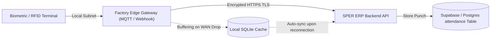

# SPER ERP — Attendance & Leave Management Module Documentation
**Branch:** `feature/attendance`  
**Base Branch:** `angular-migration`  
**Framework:** Angular (Standalone Architecture)  
**Schema Compatibility:** Fully compliant with PostgreSQL / Supabase base tables  

---

## 1. Executive Summary
The **Attendance & Leave Management Module** handles employee time-tracking, shift check-ins/check-outs, automated delay calculations, absence sanctioning, and the leave request approval workflow.

This implementation migrates the legacy attendance interface into an Angular standalone component architecture with full UI validation, reactive signals, loading/error states, and dark/light enterprise styling matching the design language of `SPER_ERP`.

---

## 2. Review of Current QR Code Attendance Mechanism

### 2.1 How the QR Station Operates
In the factory environment, a dedicated kiosk monitor or tablet runs the QR Station view:
- **Dynamic Rotation:** The station generates a compact JSON token and redraws the QR matrix every **5,000 milliseconds (5 seconds)**.
- **Token Payload Structure:**
  ```json
  {
    "hr_id": "qr-station-factory-1",
    "timestamp": 1729976400000,
    "type": "hr_qr"
  }
  ```
- **Anti-Spoofing & Replay Mitigation:**
  1. **Short Expiration Window:** When scanned by the employee's mobile camera or web scanner, the system verifies `|Now - token.timestamp| <= 45 seconds`. If an employee photographs the QR code to send to a coworker, it expires before it can be re-scanned.
  2. **Single-Use Token Verification:** The backend verifies that the token has not already been used by checking the `qr_tokens` table.
  3. **Location Tracking:** Geo-coordinates or station identifier (`check_in_location`) are captured with every punch event.

---

## 3. Future IoT Integration Blueprint (Hardware-Agnostic)

> [!IMPORTANT]
> This architecture does **not** assume specific hardware models or premature physical connections before corporate approval. Instead, it defines standardized, vendor-neutral integration contracts.

### 3.1 Supported Device Classes
- **Biometric Terminals:** Optical/Capacitive fingerprint or facial recognition scanners (e.g., ZKTeco, Anviz).
- **RFID/NFC Turnstiles:** Physical access gates reading employee badge tags at factory entrances.
- **Industrial Microcontrollers:** ESP32 / ARM Cortex edge controllers managing turnstile relays.

### 3.2 Ingestion Protocols & Network Topology


### 3.3 Standard REST API Integration Contract
Future IoT devices or edge brokers will report punch events to:

```http
POST /api/attendance/iot-event
Content-Type: application/json
X-Device-Id: "GATE-A-TURNSTILE-01"
X-Device-Signature: "hmac-sha256-signature"
```

**Payload:**
```json
{
  "device_id": "GATE-A-TURNSTILE-01",
  "employee_rfid": "RFID-994821",
  "employee_id": "550e8400-e29b-41d4-a716-446655440000",
  "direction": "check_in",
  "timestamp": "2026-10-26T07:58:22Z",
  "verification_method": "fingerprint",
  "offline_buffered": false
}
```

---

## 4. Database Schema Alignment

All fields and data structures strictly map to existing database tables without schema modifications:

| Database Table | Column | Type | Application Usage |
| :--- | :--- | :--- | :--- |
| `attendance` | `id` | UUID | Primary key |
| `attendance` | `employee_id` | UUID | Foreign key referencing `users(id)` |
| `attendance` | `employee_name` | TEXT | Display name |
| `attendance` | `department` | TEXT | Departmental segmentation |
| `attendance` | `date` | DATE | Date of attendance (YYYY-MM-DD) |
| `attendance` | `check_in` | TIMESTAMPTZ | Ingress timestamp |
| `attendance` | `check_out` | TIMESTAMPTZ | Egress timestamp |
| `attendance` | `shift` | TEXT | Shift schedule |
| `attendance` | `delay_minutes` | INTEGER | Lateness duration in minutes |
| `attendance` | `working_hours` | NUMERIC(5,2) | Total computed working hours |
| `attendance` | `status` | TEXT | `'present'` \| `'checked_in'` \| `'absent'` |
| `attendance` | `check_in_location` | TEXT | Station ID / Gate location |
| `leave_requests` | `type` | TEXT | `'Annual'`, `'Sick'`, `'Emergency'`, `'Unpaid'`, `'Casual'` |
| `leave_requests` | `start_date`, `end_date` | DATE | Leave calendar interval |
| `leave_requests` | `days` | NUMERIC(4,1) | Number of days |
| `leave_requests` | `status` | TEXT | `'pending'`, `'pending_manager'`, `'pending_hr'`, `'approved'`, `'rejected'` |
| `late_deductions` | `delay_minutes`, `amount` | INT, NUMERIC | Automatic financial penalties for tardiness |
| `hr_absence_records` | `penalty_days`, `hr_decision` | NUMERIC, VARCHAR | Sanctions for unexcused absence |

---

## 5. Screen Breakdown & User Experience

1. **Daily Attendance Logs:** Filterable by department and status with employee avatars, shift tags, clock times, delay badges, and location tags.
2. **Delays & Absence Tab:** Dual-panel view highlighting late salary deductions and unauthorized absence records with sanction details.
3. **Leave Requests & Approvals:** Status pills (`All`, `Pending Manager`, `Pending HR`, `Approved`, `Rejected`), emergency flag tags, and interactive **Approve** and **Reject** (with reason modal) review controls.
4. **Live QR Station & Scanner:** Live kiosk simulator with SVG QR code rendering and mobile check-in/check-out simulation with real-time validation.
5. **Architecture Documentation:** Embedded interactive reference for engineering and operations teams.

---

## 6. How to Test & Verify Locally
In PowerShell from `frontend-angular`:
```powershell
# 1. Run local dev server
npm start

# 2. Open browser at
http://localhost:4200/attendance

# 3. Test production build
npm run build
```
Verify that:
- Metrics count live data correctly.
- Tabs switch with zero latency.
- Submitting a new leave updates the list immediately.
- Approving or rejecting updates status badges.
- QR code refreshes smoothly every 5 seconds.
